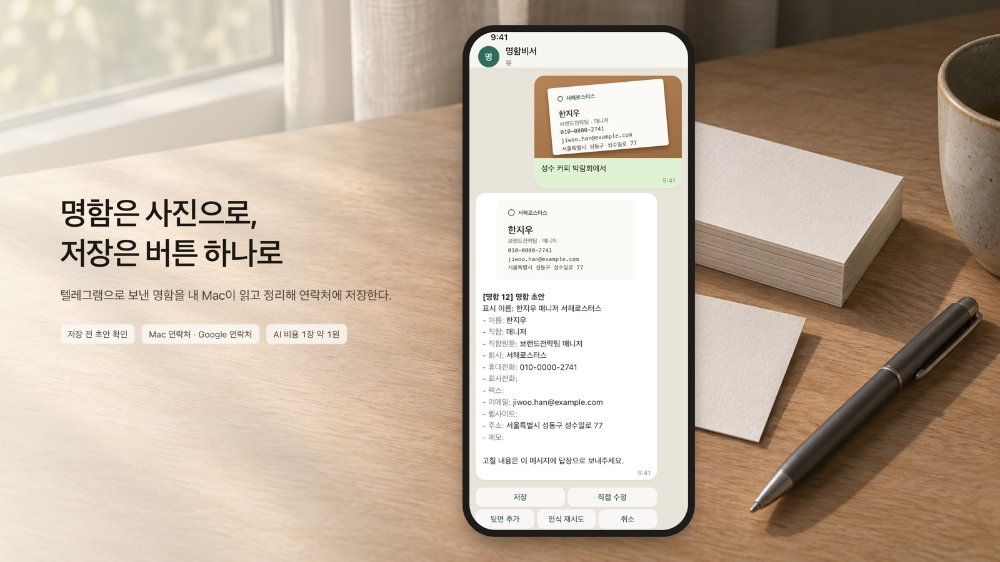
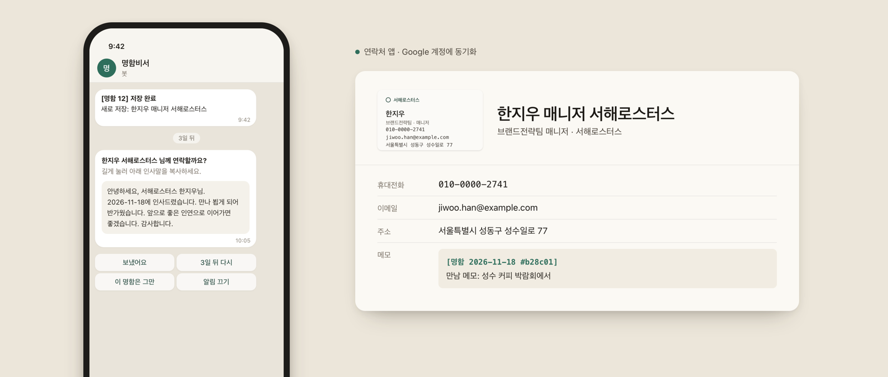
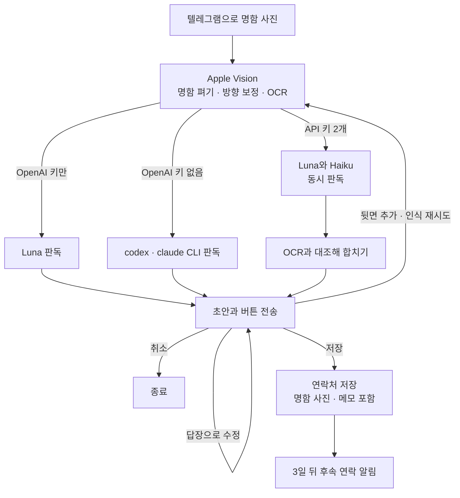
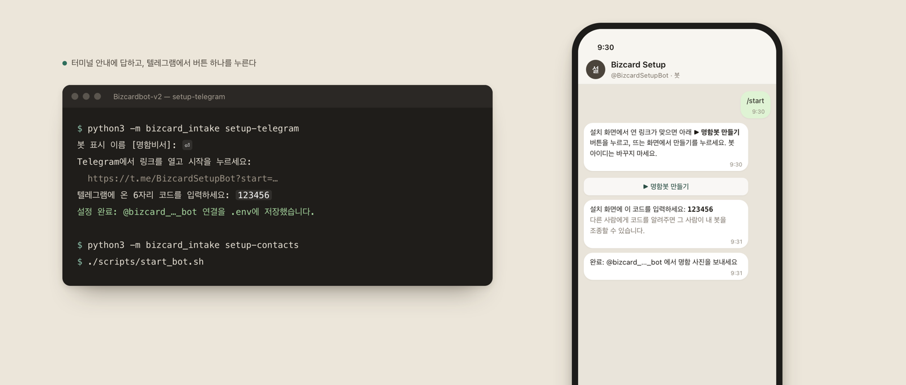
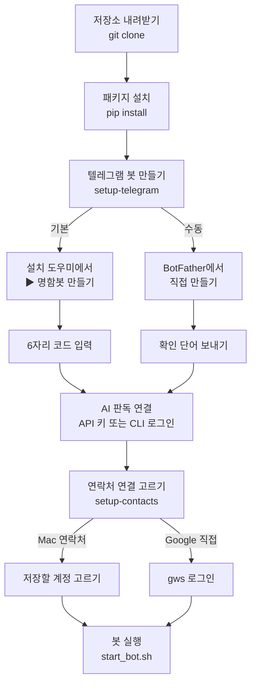

<p align="center">
  
</p>

# Bizcardbot-v2

명함 사진을 텔레그램으로 보내면 내 Mac이 읽고 연락처에 저장한다.
저장 전에 초안을 보여 주고, 버튼으로 저장하거나 고친다.
명함 1장의 AI 비용은 약 1원이다(API 키 2개 기준).

현재 버전: **2.3.1** · [Quick start](#quick-start) · [새 소식](#새-소식-whats-new) · [변경 기록](CHANGELOG.md)

## 이렇게 쓴다

1. 명함 사진을 봇에게 보낸다. 사진에 캡션을 달면 만남 메모가 된다.
2. 초안을 확인하고 `저장`을 누른다. 틀린 곳은 초안에 답장해 고친다.
3. 명함 사진과 메모가 연락처에 들어간다. 3일 뒤 봇이 인사말과 함께 연락할지 묻는다.

<p align="center">
  
</p>

예시 이미지의 인물, 회사, 연락처는 모두 가상이다.

| 기능 | 내용 |
| --- | --- |
| 방향 보정 | 비뚤거나 뒤집힌 사진을 펴고 바로 세운다. |
| 종이색 정리 | 누렇거나 푸른 종이를 하얗게 맞춘 사진을 연락처에 넣는다. |
| 교차 확인 | API 키가 2개면 두 AI 모델이 따로 읽고 OCR과 맞춰 본다. |
| 언어 | 한국어, 영어, 가로쓰기 일본어·중국어 명함을 읽는다. |
| 저장 위치 | Mac 연락처(iCloud·Google 계정) 또는 Google 직접 연결 |
| 이직·승진 | 같은 사람의 새 명함이면 기존 연락처 갱신을 제안한다. |
| 후속 연락 | 저장 3일 뒤 복사할 인사말을 보낸다. |
| 내보내기 | `CSV 내보내기` 버튼으로 저장한 명함을 내려받는다. |

## 작동 흐름



글자 인식(OCR)과 사진 정리는 Mac 안에서 한다.
처음 판독할 때 AI 모델에는 사진과 OCR 글자를 보낸다.
뒷면 병합에는 앞뒤 초안을, AI 수정에는 초안과 수정 답장을 보낸다.
자세한 범위는 [Privacy](#privacy)에 있다.

## 설치 흐름

<p align="center">
  
</p>



필요한 것은 켜 둔 Mac과 텔레그램이다.
AI 판독에는 OpenAI API 키나 ChatGPT·Claude 구독(CLI) 중 하나가 필요하다.
Anthropic 키는 OpenAI 키와 함께 있을 때 교차 확인에 쓴다.
Mac 연락처에서 Google 계정을 고르면 Google Cloud 설정 없이 동기화한다.

명령과 순서는 [Quick start](#quick-start)에 있다.
v1 사용자는 [업그레이드 방법](CHANGELOG.md)을 따른다.

## 명함 1장 비용

명함 1장의 AI 비용은 토큰 사용량 실측으로 계산한 약 0.9~1.2원이다.
청구서와 대조한 금액은 아니다.

OCR은 Mac의 Apple Vision이 하므로 비용이 없다.
비용은 AI 모델(Luna, Haiku) 호출에서 생긴다.
아래 수치는 단면 명함을 처음 판독하는 비용이다.

| 측정 | 1장 비용 |
| --- | ---: |
| 운영 Mac 실기 시험, 시험 명함 1장 2회 (2026-11-18) | 0.89~0.95원 |
| 실제 명함 17장 평균, 캐시 적용 (2026-11-17) | 약 0.96원 |
| 실제 명함 17장 평균, 캐시 없음 가정 | 약 1.16원 |

캐시 적용 값은 Luna 입력의 약 99.8%를 캐시에서 읽은 기록이다.
운영 중 캐시 적중률은 확인하지 않았다.

| 한 달 인식 장수(단면, 재인식·AI 수정 없음) | 예상 AI 비용 |
| --- | ---: |
| 30장 | 약 29~35원 |
| 100장 | 약 96~116원 |
| 300장 | 약 288~348원 |

월 비용은 실제 명함 17장의 두 평균(0.96원, 1.16원)으로 계산했다.

- 기본 교차 확인 기준이다. `OPENAI_API_KEY`와 `ANTHROPIC_API_KEY`가 모두 있어야 한다.
- OpenAI 키만 있으면 Luna만 호출한다. 이때는 1장에 약 0.20~0.40원이다.
- codex·claude CLI 방식은 이 계산에 들지 않는다.
- 환율 1달러 1,335원과 2026-11-17 확인 단가로 계산했다. 세금과 환전 수수료는 뺐다.
- Mac 전기료는 넣지 않았다. 텔레그램은 무료다.
- 비용은 글자 양과 캐시 적중에 따라 달라진다.
- 양면 명함은 앞뒤 판독에 병합 호출 1번이 더 든다. 총비용은 측정하지 않았다.
- 답장 문장으로 고치면(AI 수정) 호출마다 비용이 더 든다. `항목: 값` 형식 수정은 AI를 쓰지 않는다.
- 봇은 비용을 토큰 사용량으로 계산해 기록한다.
- 사진 1번 인식 비용이 기준(기본 2원, `BIZCARD_COST_WARN_KRW`)을 넘으면 초안에 한 번 표시한다. AI 수정 비용은 이 기준에 넣지 않는다.
- `CSV 내보내기` 안내에 저장한 명함의 평균 비용이 나온다.
  평균에는 앞면·뒷면·AI 수정 비용이 모두 들어간다.
  비용 기록이 있는 명함만 계산한다. 기록이 하나도 없으면 평균을 숨긴다.

## 새 소식 (What's new)

- **v2.3.1**은 문서 패치다. README를 예시 이미지와 흐름도로 다시 구성하고 [명함 1장 비용](#명함-1장-비용) 절을 추가한다.
  봇 동작은 v2.3.0과 같다. v2.3.0보다 오래된 버전은 [v2.3.0 업그레이드 방법](CHANGELOG.md#230---2026-11-18)을 먼저 따른다.
- **v2.3.0**은 만남 메모, CSV 내보내기, AI 비용 기록, 주소 판독 비교, 수정 없이 저장 비율을 추가한다.
  Mac 연락처 방식은 처음 한 번 Mac 화면에서 '허용'을 눌러야 메모가 들어간다.
  [v2.3.0 새 기능](#v230-새-기능)과 [업그레이드와 설정 변경](CHANGELOG.md#230---2026-11-18)을 확인한다.
- **v2.2.0**은 일본어·중국어 명함 인식과 이직·승진 갱신 선택을 추가한다.
  저장 후 기본 3일 뒤에 복사할 인사말과 후속 연락 알림을 제공한다.
  [업그레이드와 설정 변경](CHANGELOG.md#220---2026-11-17)을 확인한다.
- **v2.1.1**은 릴리스 노트 링크와 공개 전 검사를 고친 패치다. 봇 동작은 v2.1.0과 같다.
- **v2.1.0**은 Mac 연락처 저장과 계정 선택을 추가한다.
  `python3 -m bizcard_intake setup-contacts`로 연결 방식을 고른다.

<details>
<summary>v2.0.0 변경 내용</summary>

- **v2.0.0**은 새 저장소로 옮긴 첫 정식 버전이다.
- 명함 방향을 자동으로 바로잡는다. 명함 17장을 네 방향으로 돌린 68건을 모두 바로잡았다.
  다른 사진에서는 결과가 다를 수 있다.
- 연락처 사진의 종이색을 스캐너처럼 하얗게 맞춘다. 푸르거나 누렇게 찍힌 명함도 깨끗하게 저장된다.
  금색·검정처럼 진한 색 명함은 그대로 둔다.
- 명함 1장 처리 시간은 중앙값 약 4.5초→4.0초로 줄었다(17장 1회 측정, 네트워크 변동 포함).
  두 번째 확인 모델(Haiku)의 응답을 짧게 줄였다(중앙값 3.4초→2.8초).
  17장 비교에서 연락처 값 손실은 관측되지 않았다.
- `setup-telegram`으로 봇 생성과 허용 사용자 설정을 안내한다. 수동 경로도 지원한다.
- 봇 시작 스크립트와 CLI는 `.env`를 설정 값으로만 읽는다.
- 같은 봇이 다른 곳에서도 실행되면 봇 사용자에게 Telegram 메시지로 알린다.
  토큰 도용일 때도 같은 알림이 온다.
- Cloud 미리보기는 배포 전이다. 변경과 이전 방법은 [CHANGELOG](CHANGELOG.md)를 확인한다.

</details>

기여자는 [버전 관리와 릴리스 규칙](RELEASING.md)을 따른다.
`python3 scripts/release.py history`는 Git 전체 이력의 개인정보 패턴과 이미지 파일을 검사한다.
README 그림은 `docs/assets/public-images.txt`에 등록한 파일만 허용한다.

## v2.3.0 새 기능

- 사진 캡션을 만남 메모로 추가한다.
  사진마다 캡션이 있으면 그 캡션을, 없으면 앨범의 첫 캡션을 쓴다.
  뒷면 캡션은 앞면 캡션이 없을 때 해당 명함에만 추가한다.
  저장한 연락처 메모에 `[명함 2026-11-18 #8ef3ef]` 같은 줄이 추가된다. `#` 뒤는 명함 식별자다.
  날짜는 사진을 받은 날이며, 다른 메모가 없어도 기록한다.
  만남 메모와 명함 부가 정보를 기존 메모 끝에 덧붙인다.
  이전 소속과 확인 필요 항목도 값이 있으면 추가한다.
  Google 직접 연결은 저장 때 기록한 부가 정보와 확인 필요 항목을 반복하지 않는다.
- `CSV 내보내기` 버튼으로 저장한 명함을 내려받는다.
  `/export`도 사용할 수 있다. 요청한 대화의 저장 명함만 포함한다.
- 사진별 AI 비용을 기록한다. 기준을 넘으면 초안에 참고 문구를 표시한다.
- 두 모델의 주소가 엇갈리면 OCR과 맞는 쪽을 고르고, 두 값을 함께 보여 확인을 돕는다.
- 수정 없이 저장한 비율을 기록한다. CSV 전송 안내에 비율과 평균 비용을 기록 건수와 함께 표시한다.

다음 권한 버튼 단계는 Mac 연락처 방식 전용이다.
메모 대기 안내의 `메모 권한 요청` 버튼을 누른다.
처음 한 번 Mac 화면에서 '허용'을 누른다.
거부했다면 시스템 설정의 자동화 권한을 켜고 `다시 확인`을 누른다.
시작하거나 저장할 때는 동의 창을 자동으로 띄우지 않는다.

메모는 저장 뒤 약 1분 후에 추가한다.
미허용 상태의 자동 확인은 15분마다 수행한다.
`메모 권한 요청`과 `다시 확인` 버튼은 즉시 확인한다.
Google 연락처 표시는 Mac의 Google 동기화가 끝난 뒤 확인한다.
연락처 앱은 백그라운드에서 실행한다.
권한을 허용하기 전에도 연락처 저장은 완료한다.

CSV에는 전화번호와 이메일 등 개인정보가 포함된다.
공유할 대상과 보관 위치를 확인한다.
파일이 45MB를 넘으면 Telegram으로 보내지 않는다.

기존 사용자는 업데이트 후 봇을 다시 시작한다.
새 설정은 [`.env.example`](.env.example)을 참고한다.
설정을 추가하지 않아도 기본값을 사용한다.

| 설정 | 기본값 | 용도 |
| --- | --- | --- |
| `BIZCARD_MEETING_NOTE` | `on` | `off`면 메모 추가와 권한·대기 안내를 끈다. |
| `BIZCARD_USD_KRW` | `1335` | AI 비용의 원화 환산에 사용한다. |
| `BIZCARD_COST_WARN_KRW` | `2` | 사진 한 번의 인식 비용이 넘으면 안내한다. |
| `BIZCARD_ADDRESS_ARBITRATION` | `on` | 주소 판독을 비교한다. `off`로 끈다. |

### 알려진 문제

기존 저장 명함의 메모는 소급해서 채우지 않는다.
CSV의 해외 번호는 수식 실행 방지를 위해 `+` 앞에 작은따옴표를 붙인다.
OCR도 함께 틀린 주소는 자동 교정하지 못한다.
캡션은 300자, 메모 블록은 2,000자까지 반영한다.
CLI 대체 실행과 미지원 모델의 비용은 알 수 없어 경고하지 않는다.
CSV의 비용과 비율은 기록이 있는 명함을 기준으로 계산한다.
XLSX와 Google Sheets 내보내기는 지원하지 않는다.

## Prerequisites

| Requirement | Why | Check |
|---|---|---|
| macOS with Xcode command line tools | Apple Vision does the card rectification and OCR | `xcode-select --install` |
| Python 3.9+ with `numpy`, `Pillow` (`opencv-python` optional) | image preparation | `python3 -m pip install -r requirements.txt` |
| Optional: [`gws`](https://github.com/googleworkspace/cli), contacts scope | advanced Google direct backend only | `brew install googleworkspace-cli` |
| **One of**: [`codex`](https://github.com/openai/codex) (ChatGPT Plus/Pro/Business) or [`claude`](https://docs.anthropic.com/en/docs/claude-code) (Claude subscription) | reads the card | `codex login` / `claude login` |
| Telegram bot connection | the chat channel | `python3 -m bizcard_intake setup-telegram` |

`python3 -m bizcard_intake doctor` checks all of the above and prints the fix for
anything missing. `python3 -m bizcard_intake setup` walks you through the
missing pieces.

## Quick start

```bash
git clone https://github.com/project820/Bizcardbot-v2.git && cd Bizcardbot-v2
python3 -m pip install -r requirements.txt
cp .env.example .env
export GOOGLE_WORKSPACE_CLI_KEYRING_BACKEND=file   # before any gws call, see below
```

Then, in order:

1. Run `python3 -m bizcard_intake setup-telegram` and follow the Korean prompts.
   Enter a display name (Enter keeps `명함비서`), then open the Telegram link and
   create your bot. Enter the six-digit code sent in Telegram into the installer.
   The installer saves its token and your allowed chat ID in
   `.env` with owner-only permissions. Existing allowed chats are kept.
2. Add `OPENAI_API_KEY=` to `.env` if you want the API parser.
   Add `ANTHROPIC_API_KEY=` as well to turn on the Luna + Haiku cross-check.
3. Run `python3 -m bizcard_intake setup` to choose a contacts backend and check the parser.
   CLI commands read the project's `.env` as data; process environment values take precedence.
4. Start the bot: `./scripts/start_bot.sh`. The script reads `.env` automatically.

### Telegram setup

```bash
python3 -m bizcard_intake setup-telegram
```

자동 설정은 프로젝트 운영자가 운영하는 설치 도우미(@BizcardSetupBot)를 거친다.
도우미는 내 봇의 토큰을 저장하지 않는다.
도우미는 명함 사진과 Google 계정에 접근하지 않는다.
다만 Telegram 구조상 도우미 운영자는 내 봇의 토큰을 다시 조회할 수 있다.
토큰이 있으면 봇에 온 메시지를 읽을 수 있다.
이 점이 걸리면 `python3 -m bizcard_intake setup-telegram --manual`로 직접 만든다.
수동 경로는 도우미를 거치지 않는다.

1. 봇 표시 이름을 입력한다. Enter를 누르면 `명함비서`를 쓴다.
2. 표시된 Telegram 링크를 열고 @BizcardSetupBot인지 확인한다.
3. 도우미 메시지의 `▶ 명함봇 만들기` 버튼을 누르고 봇을 만든다. 제안된 봇 아이디는 바꾸지 않는다.
4. 도우미가 보낸 6자리 코드를 터미널에 입력한다.
5. 설치기가 봇 정보와 허용 사용자를 확인하고 `.env`에 저장했는지 확인한다.

설치기는 최대 10분 동안 3초 간격으로 확인한다.
코드 입력을 5회 틀리면 연결이 만료된다.
`BIZCARD_ONBOARDING_URL`은 프로세스 환경 변수, 대상 `.env` 순으로 읽는다.
미설정이면 기본 도우미를 쓰고, 빈 값이면 BotFather 수동 경로를 쓴다.
연결 실패나 만료 시에도 수동 경로를 안내한다.
토큰 입력은 숨기며 화면에 출력하지 않는다.
기존 연결을 바꾸려면 확인을 받는다. `--yes`는 이 확인을 생략한다.
`--no-open`은 링크를 자동으로 열지 않는다.
선택 모듈 `qrcode`가 이미 설치되어 있으면 터미널 QR 코드도 표시한다.

새 봇 생성 직후 확인이 실패하면 설치기는 최대 3회 시도한다.
그래도 실패해 설치를 다시 실행하면 봇이 하나 더 만들어진다.
마지막 수령 확인이 3회 실패하면 오류로 종료하지만 저장한 연결은 유지한다.

문제가 있을 때만 아래 명령으로 점검한다. 프로젝트의 `.env`를 데이터로 읽는다.
Google 로그인 안내가 필요하면 `doctor`를 `setup`으로 바꾼다.

```sh
python3 -m bizcard_intake doctor
```

<details>
<summary>Appendix: manual Telegram setup</summary>

Run `python3 -m bizcard_intake setup-telegram --manual`.

1. Open the official `@BotFather` in Telegram and send `/newbot`.
2. Choose the display name and a username ending in `bot`.
3. Paste the token into the installer's hidden prompt. On macOS, the installer
   checks `pbpaste` for a token first, verifies its bot username, and asks before
   using it. Declining uses the hidden prompt; no token is printed.
4. Send the installer's random confirmation word (for example, `명함-4821abcdef12`)
   exactly as displayed in a private conversation with that bot. The installer
   waits up to 120 seconds and checks every 3 seconds. Only a matching message
   dated at or after the current installation started can register its sender.
   Old updates and unrelated messages are skipped while advancing the offset.

A pre-existing webhook, polling failure, or timeout stops setup without saving
an unverified chat ID. The installer does not remove the webhook. Coordinate
with the existing operator to remove it, stop other polling processes, and
rerun `setup-telegram --manual`. Do not paste tokens into chat messages or share
them.

The bot stores its bot ID and update offset in `data/cards/_telegram.state`.
Switching to another bot resets the offset on startup. Renewing a token for
the same bot preserves the offset. Legacy state without a bot ID resets once;
this can replay updates still retained by Telegram.

</details>

Only listed chats can use the bot; everyone else gets a one-line refusal that
shows their chat id, so adding more people later is easy.

### 연락처 연결 선택

```bash
python3 -m bizcard_intake setup-contacts
```

1. **Mac 연락처 또는 Google 직접 연결을 고른다.**
   Mac 연락처가 권장 경로다. gws와 Google Cloud 프로젝트가 필요 없다.
2. **Mac의 연락처 접근 요청을 허용한다.**
3. **저장할 계정 번호를 고른다.**
   Mac에 등록된 연락처 계정을 선택한다.

Google이 목록에 없으면 시스템 설정 > 인터넷 계정에서 Google을 추가한다.
해당 계정의 연락처 동기화를 켠 뒤 `setup-contacts`를 다시 실행한다.

Google 연락처와 사진의 서버 동기화는 macOS 계정 서비스가 담당한다.
앱은 Mac 연락처에 저장한 필드를 다시 읽어 확인한다.
Google 웹 연락처의 동기화 완료까지 확인하는 기능은 없다.

`setup-contacts`는 `.env`에 아래 선택을 저장한다.

```bash
BIZCARD_CONTACTS_BACKEND=apple
BIZCARD_APPLE_CONTAINER=  # chosen account identifier; empty = Mac default account
```

기존 사용자는 백엔드를 설정하지 않아도 gws 방식을 유지한다.
직접 `python -m bizcard_intake`를 실행하면 프로세스 환경 변수가 `.env`보다 우선한다.
`./scripts/start_bot.sh`는 `.env` 값을 export하므로 기존 환경 변수를 덮어쓴다.
Google 직접 연결을 고르면 `BIZCARD_CONTACTS_BACKEND=google`을 저장한다.

launchd 봇은 처음 실행할 때 연락처 접근을 다시 요청할 수 있다.
요청 창에는 `python3` 또는 실제 Python 실행 파일 이름이 표시된다.

거부했으면 시스템 설정 > 개인정보 보호 및 보안 > 연락처에서 Python을 허용한다.
실행 경로나 책임 프로세스가 바뀌면 다시 허용해야 할 수 있다.
부분 접근 권한은 지원하지 않으므로 전체 연락처 접근을 허용한다.

**Mac 연락처 메모는 자동화 권한을 허용한 뒤 추가한다.**
연락처 저장을 마친 뒤 메모 대기열에서 처리한다.
미허용 상태에서도 연락처 저장은 완료한다.

Google 직접 연결은 기존 메모 저장을 유지한다.

Mac 연락처는 생성과 갱신 전에 저장 작업을 명함 파일에 기록한다.
작업에는 원래 계정과 대상 식별자, 최초 일치 식별자 집합을 보관한다.
이름과 전체 전화번호·팩스·이메일도 대조 정보로 보관한다.
설정을 바꿔도 진행 중인 작업과 사진 재시도는 원래 계정을 쓴다.

생성 응답이 끊기면 최초 집합과 비교해 새 연락처 한 건을 채택한다.
최초 식별자가 사라졌거나 새 후보가 없거나 여러 건이면 확인을 요청한다.
조회에서 연락처가 보이지 않아도 자동으로 다시 생성하지 않는다.
갱신은 원래 대상에 값을 추가하며 기존 이름·조직 정보와 목록 값을 보존한다.
갱신 대상 식별자가 바뀌면 같은 계정의 대조 정보로 한 건을 찾는다.
대상을 확정하지 못하면 생성으로 전환하지 않고 확인을 요청한다.

Telegram의 **이미 저장됨 / 다시 저장 / 건너뛰기** 버튼으로 선택한다.
이미 저장됨을 선택하면 추가 저장과 사진 업로드를 생략한다.
다시 저장을 선택하면 원래 계정에서 새 저장 작업을 시작한다.
다시 저장 결과에도 사진 실패와 메모 누락, 필드 검증 경고를 표시한다.
봇은 한 번에 하나만 실행한다. 봇 실행 중에는 CLI 변경 작업을 거절한다.
`scan`, `save`, `retry-pending`, `migrate-names`, `rollback-names`가 해당한다.
`doctor`와 `list`는 계속 사용할 수 있다. `list`는 이전 자료를 변환하지 않는다.
`doctor`는 작성자 잠금이 사용 중인지 비어 있는지 표시한다.
봇 시작은 기존 작성자의 종료를 최대 20초 기다린다.
잠금이 계속 사용 중이면 한국어 안내와 함께 종료한다.
CLI 변경 작업은 봇을 종료한 상태에서 실행한다.
자동 실행 봇은 `launchctl stop` 후 다시 실행되므로 일반 작업은 Telegram에서 처리한다.
`migrate-names`와 `rollback-names`는 아래 정비 절차로 실행한다.

1. 자동 실행 서비스를 해제한다.
   ```bash
   launchctl unload -w ~/Library/LaunchAgents/com.bizcard.intake.plist
   ```
2. `python3 -m bizcard_intake doctor`에서 작성자 잠금이 비었는지 확인한다.
   사용 중이면 이전 봇의 작업 종료를 기다린다.
3. 필요한 명령 하나를 실행한다. 롤백 경로는 실제 백업 파일로 바꾼다.
   ```bash
   python3 -m bizcard_intake migrate-names --apply
   # 되돌리기가 필요한 경우에만 실행한다.
   python3 -m bizcard_intake rollback-names data/name-migration/<backup>.json
   ```
4. 작업 결과를 확인한 뒤 자동 실행 서비스를 복구한다.
   ```bash
   launchctl load -w ~/Library/LaunchAgents/com.bizcard.intake.plist
   ```

확인 버튼은 작업 전에 응답해 Telegram의 대기 표시를 끝낸다.
이직 조회 완료가 카드 잠금과 겹치면 작업자에서 최대 30초 재시도한다.
재시도 시간이 지나면 이직 제안을 생략하고 일반 저장 버튼을 복구한다.
조회 대기가 20초 이상이면 저장 요청으로 일반 저장을 진행할 수 있다.
조회 시작 시각이 없으면 대기 시간이 지난 것으로 처리한다.
재시작하면 남아 있는 조회 대기 상태를 해제한다.
답장 대상 선택은 v2.1.1과 같다. 카드의 최근 메시지 참조 20개를 조회한다.
발신자나 원본 시각으로 별도 판단하지 않는다.
대상을 찾지 못하면 검토 가능한 명함 한 건을 자동 선택한다.
텍스트 답장에서 저장·취소된 명함을 찾으면 종료 상태를 안내하고 수정하지 않는다.
사진 답장은 v2.1.1의 뒷면 대상 선택을 유지한다.
답장한 명함이 종료됐어도 다른 명함이 뒷면 대기 중이면 그 명함에 추가될 수 있다.
전송 직후 답장 대상을 메모리에 등록한다.
메시지 ID는 v2.1.1처럼 호출한 스레드에서 카드 잠금을 기다려 기록한다.
저장된 카드를 다시 읽고, 없는 ID만 끝에 추가해 마지막 20개를 남긴다.
기록 시도가 끝나면 성공 여부와 관계없이 메모리 참조를 지운다.
잠금 대기 중에는 메모리 참조로 원래 명함을 찾는다.
잠금 대기와 파일 쓰기가 끝날 때까지 해당 호출자는 기다린다.
따라서 업데이트 처리 중 기록하면 다른 대화의 처리도 늦어질 수 있다.
OCR·AI 인식 중에는 카드 잠금을 유지하지 않는다.
기록 실패나 기록 전 종료로 참조를 잃으면 v2.1.1의 자동 선택을 따른다.
예를 들어 참조 없는 저장 명함 A에 답장하면 검토 명함 B가 선택될 수 있다.
확인한 초안 메시지에 답장한다.
인식 중 취소를 요청하면 인식이 끝난 뒤 취소한다. 재시작 후에도 요청을 반영한다.
처리 중인 카드의 다른 버튼과 수정 요청에는 즉시 대기 안내를 보낸다.
저장 중에는 수정·뒷면 추가·인식 재시도 버튼으로 명함을 변경하지 않는다.
저장 여부가 불명확하면 뒷면 사진도 반영하지 않는다. 저장 결과를 확인한 뒤 사진을 다시 보낸다.
한자가 많은 한국어 명함에서 한자와 한글이 한 줄에 함께 있으면 그 줄의 한글 이름·주소가 빠지거나 한자로 잘못 읽힐 수 있다.
초안을 확인하고 직접 수정한다. AI가 누락된 한글을 복구하는지는 확인하지 않았다.
저장 결과를 명함 파일에 기록한 뒤 원본 이미지를 정리한다.
목록은 저장 중인 명함을 `저장 중`으로 표시한다.
새 확인 단계에서는 이전 버튼을 사용할 수 없다.
기존 v2.0.0 명함에는 새 작업 기록이 없어도 기존 Google 저장을 유지한다.
Mac 권한 알림은 같은 상태에서 24시간마다 재알림한다.
마지막 알림을 로컬에 보관하므로 봇 재시작으로 반복하지 않는다.
Google 점검 알림은 `BIZCARD_ALERT_CHAT_ID`가 있을 때만 보낸다.

### Google login, once (advanced gws backend)

```bash
GOOGLE_WORKSPACE_CLI_KEYRING_BACKEND=file gws auth login --scopes https://www.googleapis.com/auth/contacts
```

Always run `gws` with `GOOGLE_WORKSPACE_CLI_KEYRING_BACKEND=file` (`.env.example`
sets it for the bot; add the export to your shell profile too). If one call uses
the macOS keychain instead, `gws` cannot decrypt the stored login, deletes it and
you have to log in again.

`gws` needs an OAuth client in **your own** Google Cloud project. With `gcloud`
installed, `gws auth setup --login` creates the project and client for you;
without it, `setup` prints the manual console steps. Two things keep the login
from expiring:

- Request only the contacts scope (command above). The default `cloud-platform`
  scope puts the token under Workspace reauth policies.
- Personal Gmail accounts can only create *External* apps: publish the app to
  **In production** in the console. In *Testing* status Google kills the refresh
  token every 7 days. Workspace accounts should pick *Internal*, which never
  expires.

If the token still dies (password change, admin revocation, 6 months unused),
the bot tells the `BIZCARD_ALERT_CHAT_ID` chat within a day, failed saves stay
on hold as cards and are saved automatically after you log in again
(`python3 -m bizcard_intake retry-pending` forces it).

Keep the encryption key in a file so every caller (launchd, Terminal, agents)
can read it: set `GOOGLE_WORKSPACE_CLI_KEYRING_BACKEND=file` in `.env` and in your
shell profile, and log in with the same variable set. A gws run in keychain mode
that cannot read the key deletes `credentials.enc`.

## Using the bot

1. Send one or more card photos (an album is fine). Every photo becomes its own
   card with a number, a preview image and a draft:
   ```
   [명함 12] 명함 초안
   표시 이름: 정호준 영업팀장 누리네트웍스

   - 이름: 정호준
   - 직함: 영업팀장
   - 직함원문: 영업팀장/컨설턴트 (Sales Executive)
   - 회사: 누리네트웍스
   - 휴대전화: 010-5555-0101
   ...
   ```
   Buttons: 저장 · 직접 수정 · 뒷면 추가 · 인식 재시도 · 취소. For an album the bot
   also sends a summary with "저장 가능한 N건 모두 저장".
   Horizontal Japanese and Chinese cards are supported. The Korean recognition
   path is preserved; OCR results matched v2.1.1 on 17 cards (15 Korean, 2 English).
   On Korean cards with many Chinese characters, Hangul names or addresses on
   the same line as Chinese characters may be omitted or misread as Chinese
   characters. Check the draft and correct it manually; AI recovery of omitted
   Hangul has not been verified.
   Vertical Japanese body text is unsupported. Rotated vertical text may be
   misread as Hangul. Check names and companies and correct them manually.
2. To fix a card, reply to its draft with `항목: 값` lines (`직함: 과장`,
   `휴대전화: 010-1234-5678`, `팩스: -` to clear). These are applied as typed,
   without the AI, and survive re-recognition and back-side merges. Free text
   ("이메일은 kim@acme.com") still goes through the AI reviser.
3. `목록` lists every card that is not saved yet, with a save-all button.
4. If Google is unreachable or logged out, the card is kept as "저장 보류" and
   saved automatically once Google works again (backoff from 2 minutes up to 6
   hours; checked every minute and at the daily health check). A contact whose
   photo upload failed is saved anyway and the photo is retried.
5. When a matching name and mobile phone or email have a different company or title, choose
   `기존 연락처 갱신` to replace the old company/title, or `새 연락처로 저장` to
   keep a separate contact. Both Mac Contacts and Google direct connections
   support this. Batch save leaves these cards out and sends each card its own
   choice buttons. Both the existing contact and the draft must have a company
   or title before this choice is offered. Empty draft values never erase the
   existing Mac company, title, or department.
   The draft appears first; save buttons are attached after the contact lookup.
   A lookup that exceeds its 3-second request limit can skip this suggestion on
   very large contact lists. Check `job-change lookup unavailable` in `bot.log`.
   The first Mac helper build can add up to 30 seconds.
   An unresolved save freezes the draft and its previous operation until the
   result is checked, including after a restart.
6. Newly saved cards get a follow-up reminder after 3 days by default. Long-press
   the greeting to copy it, then send it yourself. Fixed Korean, Japanese, Chinese
   and English templates add no AI cost. Names select the template language;
   Taiwan/Hong Kong numbers (+886/+852) or traditional-only characters select
   traditional Chinese; other Chinese names use simplified Chinese.
   A Japanese name written only in kanji gets the Chinese template, so edit it
   before sending. Cards saved before the upgrade do not get reminders.
   Reminders arrive 10:00–18:59 in `BIZCARD_TZ` (system local time when empty).
   An invalid value also uses system local time, logs one fixed warning, and
   produces a warning in `doctor`. Use `Asia/Seoul`, not `KST`.
   Set `BIZCARD_FOLLOWUP_DAYS=0` in `.env` to disable them, or change `3` to the
   number of days you prefer, then restart the bot.

<details>
<summary>Concurrency, reply selection and parallel processing</summary>

Only one bot or mutating CLI command can run per data directory.
While the bot runs, use Telegram for changes; `doctor` and `list` remain
available. `list` no longer migrates legacy records.
`doctor` reports whether the writer lock is held or free without changing it.
Bot startup polls for up to 20 seconds while the previous writer exits.
If still held, startup fails with a Korean message.
Lookup completion retries card-lock contention on its worker for up to 30
seconds, then restores normal save buttons without a job-change suggestion.
A save request may bypass a pending lookup at least 20 seconds old or one
without a start timestamp. Restart
recovery clears leftover lookup flags. Confirmation buttons are acknowledged
before their work starts.
Cancellation during recognition takes effect when recognition finishes and
survives restart. Other actions on a busy card receive an immediate notice.

Reply selection retains v2.1.1 behavior, using the last 20 message IDs per
card. Sender/date metadata does not change selection. An unresolved reply
falls back to the single reviewable card. A TEXT reply resolving to a
saved/cancelled card gets the existing closed-state notice and is not edited.
Photo replies keep v2.1.1 back-side selection: even a reply to a closed card
can add a back side to another card waiting for one.
Delivered messages are registered in memory immediately. As in v2.1.1,
the calling thread waits for the card lock and writes the message ID.
It reloads the card, appends the ID only if absent, and keeps the last 20 IDs.
The temporary entry is removed when the write attempt ends, including errors.
Replies during the wait resolve through that entry to the original card.
Lock waits and disk writes block the caller; recording on the update loop
can delay other chats. OCR and AI recognition do not hold the card lock.
A failed write or a crash before persistence can lose the reference.
As in v2.1.1, replying to an unrecorded saved card A can select the
sole reviewable card B. Reply to a verified draft message.
Cards are processed in parallel (`BIZCARD_WORKERS`, default 30): the model
calls for every card in an album run at the same time, image prep and OCR
use at most one slot per CPU core, and saves run in the background so buttons
stay responsive. 30 real cards took 7 s from upload to finished drafts. An
album gets one progress message (later the summary with "모두 저장") and one
photo+draft message per card; messages to a chat are spaced out and
Telegram's 429 retry_after is honoured. Batch saves go to Google one contact
at a time (Google's guidance for one user) and share a single address-book
scan. A per-card lock keeps double taps,
batch saves and automatic retries from saving the same card twice.

</details>

| Reminder button | Action |
| --- | --- |
| `보냈어요` | Ends follow-up reminders for this card. |
| `3일 뒤 다시` | Reminds you again in 3 days. |
| `이 명함은 그만` | Stops reminders for this card without marking it sent. |
| `알림 끄기` | Turns off all follow-up reminders and shows `알림 다시 켜기`. |
| `알림 다시 켜기` | Enables pending reminders and reminders for future saves. |

Send `/alerts` or `알림 설정` at any time to turn reminders on or off.
Re-enabling does not revive a card already marked sent, stopped, or disabled;
this includes the card whose reminder you used to turn all reminders off.
`BIZCARD_FOLLOWUP_DAYS=0` still prevents sending: change it to a positive number
and restart the bot first.

A reminder interrupted during sending is not automatically resent, to prevent
duplicates; an uncertain delivery can therefore be missed.
Each reminder makes one HTTP attempt (10-second timeout), without retrying or
waiting on Telegram 429 responses. A failed attempt remains marked as attempted
and is not automatically resent. Network sending releases the card and reminder
locks, so other cards can finish saving while delivery is in progress.

Cards live in `data/cards/<id>.json` (one file each, atomic writes). Old
`data/sessions` and `data/pending_contacts` files are migrated on startup:
entries already saved are retired, approved-but-failed ones become retry
cards, and drafts nobody approved stay in review and are never saved on their
own.

### Design choices (Korean cards)

- The phone shows `이름 짧은직함 회사`, e.g. `최민준 차장 (주)다솔이엔지`.
  That whole string is Google's *given name*; *family name* stays empty so the
  device's first/last-name order cannot put the company first. The full title
  and company stay in the organization fields.
- No title is invented; a card without one gets a 확인 필요 note.
- `052-555-0126~7` is saved as two numbers without asking.
- The card is turned upright from the text itself: every line Apple Vision reads
  votes for its reading direction (characters x confidence). A card that comes out
  sideways or upside down after rectification is rotated, OCR runs once more to
  confirm, and vertical cards stay vertical. If the vote is unclear the image is
  left as is and the draft says 명함 방향 확인 필요. Check a folder of your own
  photos with `python3 scripts/eval_orientation.py <folder>`.
- The contact photo gets scanner-style paper whitening: the bot estimates the
  card's paper color from the card itself and turns light, slightly tinted
  paper (bluish, yellowish, dull gray) close to clean white. Logos and text
  largely keep their colors. Dark or strongly colored cards (gold, black, red stock)
  are left as they are, as are photos where no card rectangle was found. Only
  the contact photo changes; OCR and AI reading use the original pixels.
- Duplicate detection scans all contacts and needs a matching mobile number and
  exact name; a retry reuses the contact id the first attempt created.
- Card images are deleted after a successful save.

### Renaming contacts saved with the old layout

Contacts saved before November 2026 have the company in the family name.
For a launchd installation, unload the service first (`stop` restarts it):

```bash
launchctl unload -w ~/Library/LaunchAgents/com.bizcard.intake.plist
python3 -m bizcard_intake doctor
```

Wait until `writer` reports the lock is free. Run the required maintenance
command from the project directory (replace `<backup>` with the actual file):

```bash
python3 -m bizcard_intake migrate-names                # preview
python3 -m bizcard_intake migrate-names --apply --limit 1
python3 -m bizcard_intake migrate-names --apply        # everything, backup first
python3 -m bizcard_intake rollback-names data/name-migration/<backup>.json
```

After checking the maintenance result, restore automatic startup:

```bash
launchctl load -w ~/Library/LaunchAgents/com.bizcard.intake.plist
```

Only the name field changes; phones, company, photo and notes are untouched.

## Parser and tokens

| Backend | How | Per card |
|---|---|---|
| `openai` (default when an API key is stored) | Responses API, `gpt-6-luna`, reasoning `low`, strict JSON schema, `store: false` | billed on the OpenAI API account; token counts are logged as `openai model=... tokens in=... out=...` |
| `codex` | `codex exec` in an empty dir with `--ignore-user-config --ignore-rules`, reasoning `low` | ~5–8k tokens of the ChatGPT plan's Codex allowance |
| `claude` | `claude -p --json-schema --allowedTools Read` | Claude subscription |

**Cross-check (default when `ANTHROPIC_API_KEY` is in `.env`).** Every front
side is read by `gpt-6-luna` (reasoning `low`) and `claude-haiku-5-5` in
parallel. Phone numbers from both are merged and kept only when both models
agree, the digits appear in the Apple Vision OCR text, or they are the second
line of a `~` range; a dropped number is listed in the draft. Names and
companies that differ are shown as 확인 필요 with both readings. On 21 real
cards this gave 0 name/company/phone errors (Luna alone 1, Haiku alone 9) at
about 4 s per card and about 0.001 USD per card. If one API fails the other
result is used; if both fail the codex/claude CLI takes over.

Put the OpenAI API key in `.env` as `OPENAI_API_KEY=`, or point
`BIZCARD_OPENAI_ENV_FILE` at another env file; the bot reads only the
`OPENAI_API_KEY` line and never logs it. If no explicit file is configured,
it checks only `~/.config/openai/credentials.env`. It does not search other
projects for credentials. Without a key the bot uses Codex CLI first,
then Claude CLI when Codex is unavailable. If an API call
fails (network, quota, rate limit) the same prompt is retried once with the
codex CLI (or claude when codex is not installed). The image sent to the model is a 1024px copy; the 1600px
one is only for Apple Vision OCR. Typed `항목: 값` edits, saving and retries use no
model at all.

Set `BIZCARD_PARSER=openai|codex|claude`, `BIZCARD_OPENAI_MODEL`,
`BIZCARD_REASONING_EFFORT`, `BIZCARD_CODEX_MODEL`, `BIZCARD_CLAUDE_MODEL` in `.env`.
The default model ids are the ones this project was tuned with; if your account
does not offer them, set these variables to models you can use.

## Run as a launchd service (auto-start, auto-restart)

```bash
sed -e "s|__PROJECT_ROOT__|$PWD|g" -e "s|__HOME__|$HOME|g" scripts/com.bizcard.intake.plist \
  > ~/Library/LaunchAgents/com.bizcard.intake.plist
launchctl load -w ~/Library/LaunchAgents/com.bizcard.intake.plist

launchctl stop com.bizcard.intake        # restart = stop; launchd relaunches it
tail -f data/logs/bot.log
```

`KeepAlive` is unconditional: the bot comes back after crashes, reboots and
manual stops. At startup and every 24 hours it re-checks codex/claude and the
selected contacts backend and alerts `BIZCARD_ALERT_CHAT_ID` on failure.
When that setting is empty, only Apple Contacts permission alerts go to the
allowed chats. Google backend checks and other health alerts require
`BIZCARD_ALERT_CHAT_ID`.

## CLI

```bash
python3 -m bizcard_intake doctor              # environment report
python3 -m bizcard_intake setup               # guided fixes
python3 -m bizcard_intake setup-telegram      # create/connect a Telegram bot
python3 -m bizcard_intake setup-contacts      # choose a Mac account or gws
python3 -m bizcard_intake scan card.jpg       # parse one image locally, print the draft
python3 -m bizcard_intake save <card-id>
python3 -m bizcard_intake retry-pending     # retry saves on hold now
python3 -m bizcard_intake list              # cards not saved yet
python3 -m bizcard_intake bot                 # what start_bot.sh runs
```

## Environment variables

```bash
TELEGRAM_BOT_TOKEN=              # required Telegram bot token
TELEGRAM_ALLOWED_CHAT_IDS=       # required, comma-separated
# BIZCARD_ONBOARDING_URL=        # optional; unset = default setup helper, empty = manual BotFather path
BIZCARD_ALERT_CHAT_ID=           # health alerts
BIZCARD_PARSER=auto              # auto | openai | codex | claude
OPENAI_API_KEY=                  # openai parser (auto picks it when set)
BIZCARD_OPENAI_MODEL=gpt-6-luna
BIZCARD_REASONING_EFFORT=low
ANTHROPIC_API_KEY=               # optional cross-check with Claude Haiku
BIZCARD_ANTHROPIC_MODEL=claude-haiku-5-5
BIZCARD_CROSSCHECK=auto          # off disables the cross-check
BIZCARD_CODEX_MODEL=gpt-5.6-luna
BIZCARD_CLAUDE_MODEL=haiku
BIZCARD_PARSER_TIMEOUT=90
BIZCARD_WORKERS=30               # cards processed at the same time
BIZCARD_PYTHON=                  # interpreter with numpy/Pillow (default: python3 on PATH)
GOOGLE_WORKSPACE_CLI_KEYRING_BACKEND=file
```

## Privacy

During optional managed Telegram setup, the setup service stores pairing and
bot identity data for up to 10 minutes. It stores hashes of the poll token and
six-digit receipt code, and retrieves the bot token only when it is claimed;
the bot token is not stored on the relay. After local `.env` storage, the
installer acknowledges receipt and the service removes the pairing's personal
data, retaining only a minimal claimed marker. The manager bot operator can
technically retrieve managed bot tokens again. Manual setup bypasses the relay
and sends the token only to Telegram; clipboard detection requires confirmation
before use.

Card photos arrive through Telegram, and drafts with preview images go back to
the same chat before you approve them. Card images and OCR text are sent to
the model provider you use: the OpenAI API or Codex CLI, and Anthropic (Claude
Haiku API for the cross-check, or the Claude Code CLI). The parsed fields and
card photo go to the selected contacts account (Mac Contacts or Google directly).
Mac account services sync a Google or iCloud container to that provider. Nothing else leaves the machine. Card
records, logs and images stay locally in `data/`, which is git-ignored; the
local card images are deleted after a successful save (the profile image is kept
until a failed photo upload succeeds on retry).

## Tests

```bash
python3 -m venv .venv
.venv/bin/python3 -m pip install -r requirements.txt
.venv/bin/python -m unittest discover -s tests
```

## Cloud mode (preview, no Mac needed)

`cloud/` holds a Cloudflare Workers version for people without a Mac: one photo
becomes a draft with Save/Cancel buttons, and Save creates the Google contact.
It runs on the Workers free plan and reads the card with the model alone (no
Apple Vision), so rectification and OCR cross-checks are missing and accuracy
is not yet measured. It needs its own bot token: this Mac bot deletes webhooks
on start, so the two cannot share one. Setup, limits and costs are in
[cloud/README.md](cloud/README.md). It has only been tested locally so far.

## Roadmap

- Ship a Google-verified shared OAuth client so users do not need their own
  Cloud project (rclone-style).
- Linux support: Tesseract OCR path and a systemd unit.
