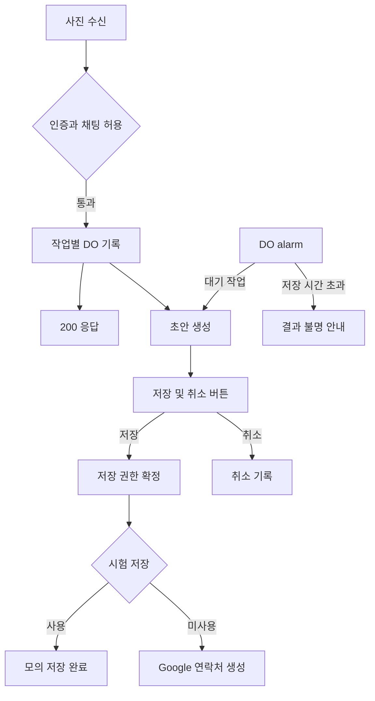

# Cloudflare Workers 연락처 PoC

`cloud/`는 로컬 컴퓨터 없이 명함을 처리하기 위한 최소 시험판이다.
현재 검증 범위는 로컬 Worker와 모킹된 외부 API다.
배포와 webhook 등록은 실행하지 않았다.

**운영 Telegram 봇 토큰을 사용하면 안 된다.**
운영 봇은 시작할 때 `deleteWebhook`을 호출한다.
같은 토큰을 쓰면 Worker의 webhook과 충돌한다.
실제 서비스 시험에는 별도 PoC 봇이 필요하다.

## 처리 흐름



## 로컬 실행

Node.js 22.12 이상이 필요하다.
`npm ci`는 개발 도구만 설치한다.
운영 Python 의존성은 바꾸지 않는다.

```sh
cd cloud
npm ci
npm test
npm run typecheck
CLOUDFLARE_LOAD_DEV_VARS_FROM_DOT_ENV=false npx wrangler dev --env local --ip 127.0.0.1 --port 8788 --local
```

`--env local`은 고정된 가상 자격증명을 사용한다.
`LOCAL_MOCK=1`이면 외부 요청을 닫힌 모의 전송기로 처리한다.
이 전송기에는 실제 `fetch`로 넘어가는 경로가 없다.
`ENVIRONMENT=local`이 아니면 모의 모드는 `503`으로 거절된다.

`.dev.vars`를 만들 필요는 없다.
저장소 루트의 `.env`를 복사하면 안 된다.
`CLOUDFLARE_LOAD_DEV_VARS_FROM_DOT_ENV=false`는 상위 `.env` 로딩을 차단한다.
기존 `cloud/.dev.vars`가 있다면 로컬 설정을 덮어쓸 수 있다.
실행 후 `/health`의 `localMock`과 `dryRunSave`가 모두 `true`인지 확인한다.

다른 터미널에서 아래 명령을 실행한다.
헤더 값은 실제 secret이 아닌 fixture의 고정 문자열이다.

```sh
curl -sS http://127.0.0.1:8788/health
curl -i http://127.0.0.1:8788/webhook \
  -H 'Content-Type: application/json' \
  -H 'X-Telegram-Bot-Api-Secret-Token: fixture-secret' \
  --data-binary @test/fixtures/photo-update.json
```

저장 버튼 예시를 전송한다.
초안 처리 중에 도착한 callback도 DO에 기록한다.
초안 기록이 끝나면 대기한 저장 결정을 처리한다.

```sh
curl -i http://127.0.0.1:8788/webhook \
  -H 'Content-Type: application/json' \
  -H 'X-Telegram-Bot-Api-Secret-Token: fixture-secret' \
  --data-binary @test/fixtures/save-update.json
curl -sS http://127.0.0.1:8788/__local/jobs/900001
```

fixture는 실제 사용자의 녹화본이 아니다.
Telegram update 형식을 재현한 가상 기록이다.
사진 ID와 연락처 값은 모두 시험용이다.
사진 `update_id`로 작업 DO를 고정한다.
같은 작업의 사진과 callback `update_id`는 7일 동안 중복 처리하지 않는다.
`/__local/jobs/<id>`는 로컬 모의 모드에서만 최소 상태를 반환한다.
반복 시험에는 fixture의 `update_id`와 callback의 작업 ID를 함께 바꾼다.

## 설정

| 설정 | 기본값 | 의미 |
| --- | --- | --- |
| `OPENAI_MODEL` | `gpt-6-luna` | Responses API 모델을 지정한다. |
| `KRW_PER_USD` | `1335` | 원화 비용 계산의 환율을 지정한다. |
| `MAX_COST_KRW` | `2` | 장당 예상 비용 상한을 지정한다. |
| `INPUT_TOKEN_BUDGET` | `8192` | 요청 전 입력 토큰 예약량을 지정한다. |
| `MAX_OUTPUT_TOKENS` | `800` | 출력 토큰 상한을 지정한다. |
| `DRY_RUN_SAVE` | `1` | OAuth와 People API 호출을 생략한다. |
| `LOCAL_MOCK` | 로컬에서 `1` | 모든 외부 API 호출을 대체한다. |
| `ALLOWED_CHAT_IDS` | 로컬에서 `424242` | 쉼표로 구분한 개인 채팅 ID를 허용한다. |

`DRY_RUN_SAVE=1`만으로 OpenAI와 Telegram 호출은 차단되지 않는다.
전체 외부 호출 차단에는 `LOCAL_MOCK=1`이 필요하다.
로컬 PoC는 두 설정을 함께 사용한다.

실제 비밀값은 `.dev.vars` 또는 향후 `wrangler secret`으로만 제공한다.
`.dev.vars.example`에는 빈 입력란만 둔다.
`cloud/.gitignore`는 `.dev.vars`와 변형 파일을 제외한다.

| 비밀 설정 | 용도 |
| --- | --- |
| `TELEGRAM_BOT_TOKEN` | 별도 PoC 봇을 인증한다. |
| `TELEGRAM_WEBHOOK_SECRET` | Telegram webhook 헤더를 검사한다. |
| `OPENAI_API_KEY` | Responses API를 인증한다. |
| `GOOGLE_CLIENT_ID` | OAuth 클라이언트를 식별한다. |
| `GOOGLE_CLIENT_SECRET` | OAuth 클라이언트를 인증한다. |
| `GOOGLE_REFRESH_TOKEN` | access token을 교환한다. |

Google refresh token에는 Contacts 쓰기 권한이 필요하다.
필요한 scope는 `https://www.googleapis.com/auth/contacts`다.
OAuth 동의 화면과 refresh token 발급은 이 PoC에 포함하지 않는다.
`JOBS`는 `JobObject` Durable Object binding이다.
`new_sqlite_classes` migration으로 SQLite 저장소를 사용한다.
Workers KV namespace와 주기적인 Cron은 사용하지 않는다.

## 비용 가드

입력 단가는 1M 토큰당 `$0.10`이다.
출력 단가는 1M 토큰당 `$0.50`이다.
기본 예약량의 예상 비용은 `1.627632원`이다.

```text
((input_tokens × 0.10 + output_tokens × 0.50) / 1,000,000) × KRW_PER_USD
```

예약 비용이 상한을 넘으면 OpenAI 호출 전에 거절한다.
0 이하 값과 잘못된 설정도 거절한다.
응답의 usage로 실제 토큰 비용을 로그에 기록한다.
입력 예약량 또는 비용 상한을 넘긴 응답은 저장하지 않는다.

**예약량은 모델 API의 입력 토큰 강제 상한이 아니다.**
모델의 이미지 토큰 산식은 이 PoC에서 검증하지 않았다.
따라서 과금 자체를 정확히 2원 이하로 보장하지 않는다.
엄격한 과금 상한에는 모델별 토큰 산식 검증이 필요하다.
단가와 모델의 실제 제공 여부도 실서비스 시험 전에 확인해야 한다.
요청은 `detail: low`와 25초 중단 시간을 사용한다.
저해상도 판독 품질은 실제 명함으로 검증하지 않았다.

## 저장 상태와 Durable Object

작업마다 `JOBS.idFromName(사진 update_id)`로 DO 하나를 선택한다.
서로 다른 Worker isolate도 같은 작업 DO에 update를 전달한다.
상태 전이는 DO의 저장소 트랜잭션과 입력 게이트로 보호한다.
Google과 Telegram 등 외부 I/O는 입력 게이트 밖에서 처리한다.

1. 사진 수신은 `queued`와 사진 `update_id` 영수증을 원자적으로 기록한다.
2. 처리 시작은 `drafting`과 60초 watchdog alarm을 원자적으로 기록한다.
3. 초안 전송 후 `awaiting_confirmation`을 기록한다.
4. 저장 결정은 `saving`과 60초 watchdog alarm을 원자적으로 기록한다.
5. Google 응답 후 `saved`를 기록한다.

callback은 별도 `update_id` 영수증과 결정을 같은 트랜잭션에 기록한다.
초안 처리 중 도착한 결정도 보존한다.
같은 작업의 최초 저장·취소 결정 하나를 처리한다.
취소는 `cancelled`로 끝나며 Google을 호출하지 않는다.
초안 오류와 초안 시간 초과는 `failed`로 끝난다.

저장 작업은 `awaiting_confirmation → saving`을 확정한 실행만 시작한다.
이미 `saving`인 작업에서는 Google 연락처 생성을 다시 시작하지 않는다.
저장 오류나 응답 불명은 `unknown`으로 기록한다.
저장 중 실행이 중단되면 DO alarm이 `unknown`으로 바꾼다.
사용자에게 다시 저장하지 말고 Google 주소록을 확인하라고 안내한다.
늦게 도착한 Google 응답은 `unknown`을 덮어쓰지 않는다.
저장 완료 알림 실패는 `saved` 상태를 바꾸지 않는다.

**Google 연락처 생성 시도는 작업당 최대 1회다.**
Google API와 DO 저장소를 함께 묶는 분산 트랜잭션은 없다.
저장 직전 중단은 실제 생성 0회로 끝날 수 있다.
Google 성공 후 중단은 실제 생성 여부를 사용자에게 확정하지 못한다.
이 경우 자동 재저장을 막아 중복 생성을 피한다.
별도 사진 작업이나 7일 만료 후 재전송은 새 작업이다.
명함 내용에 따른 연락처 중복 병합은 지원하지 않는다.

`queued`와 처리 대기 결정은 DO alarm이 복구한다.
실행이 끝나지 않은 `drafting`은 60초 후 실패로 처리한다.
중단된 초안의 OpenAI 호출은 자동 반복하지 않는다.
alarm 시각은 실행 예약 시각이며 정확한 전달 시각을 보장하지 않는다.
7일 보존 기간은 사진 작업 생성 시점부터 계산한다.
만료 alarm은 연락처 초안과 update 영수증을 함께 제거한다.
기존 KV PoC 데이터의 자동 이관은 구현하지 않았다.

## 무료 플랜과 사용량

[Cloudflare 공식 요금 문서](https://developers.cloudflare.com/durable-objects/platform/pricing/)는
Workers Free에서 SQLite 기반 Durable Object를 지원한다고 명시한다.
2026-11-17에 공식 문서를 확인했다.
유료 플랜 전환이나 배포는 실행하지 않았다.

| 항목 | Workers Free 한도 | 범위 |
| --- | --- | --- |
| DO 요청 | 100,000회/일 | HTTP 요청과 alarm 등을 합산한다. |
| DO 실행 시간 | 13,000 GB-s/일 | 외부 I/O를 기다리는 활성 시간도 계산한다. |
| SQLite 읽기 | 5,000,000행/일 | 저장소 get 등도 계산한다. |
| SQLite 쓰기 | 100,000행/일 | put과 alarm 설정 및 삭제도 계산한다. |
| SQLite 저장량 | 5GB | 계정 전체 DO 저장량을 합산한다. |

무료 한도를 초과하면 해당 작업이 오류로 실패한다.
일일 한도는 00:00 UTC에 초기화된다.
DO 한도와 Workers 자체 요청·CPU 한도는 별도로 적용된다.
공식 [제한 문서](https://developers.cloudflare.com/durable-objects/platform/limits/)에도 무료 플랜 지원을 명시한다.

기존 KV의 하루 1,000회 쓰기와 약 250장 상한은 적용하지 않는다.
DO는 Workers KV namespace의 초당 key 쓰기 제한을 사용하지 않는다.
대신 작업 상태와 영수증 및 alarm의 저장소 사용량을 합산한다.
중복 callback과 오류 경로도 요청량과 실행 시간을 사용한다.
따라서 하루 처리량을 고정된 장수로 보장하지 않는다.
실서비스 전에는 실제 사용량과 OpenAI 과금을 별도로 측정해야 한다.

## 이미지와 개인정보

Telegram photo sizes 중 긴 변이 1280px 이하인 최대 사진을 선택한다.
조건에 맞는 사진이 없으면 요청을 거절한다.
파일은 Worker가 내려받아 base64 data URL로 변환한다.
토큰이 포함된 Telegram 파일 URL은 OpenAI로 보내지 않는다.
다운로드는 5MiB 제한을 적용한다.
이미지는 DO에 저장하지 않는다.
DO에는 작업 생성부터 7일 동안 연락처 초안과 작업 상태가 남는다.
Responses API에는 `store:false`를 지정한다.
로그에는 연락처 원문과 비밀값을 출력하지 않는다.
`rotation`은 복사한 스키마에만 추가했으며 물리적 회전은 수행하지 않는다.

## 검증과 후속 과제

Vitest는 외부 `fetch`를 모킹해 webhook 인증을 확인한다.
서로 다른 Worker 모듈의 동시 저장과 DO 상태 전이를 검증한다.
지연된 초안 put 중 callback과 alarm의 결과 불명 처리도 검증한다.
비용 가드와 People API 본문도 검증한다.
로컬 전송기 시험은 실제 `fetch`가 호출되지 않았음을 확인한다.
`test/fixtures`의 JSON으로 Wrangler 통합 흐름을 재현한다.

아래 기능은 후속 과제로 남긴다.

- 수정 답장을 지원하지 않는다.
- 뒷면을 지원하지 않는다.
- 앨범을 지원하지 않는다.
- 연락처 중복 병합을 지원하지 않는다.
- 연락처 사진을 저장하지 않는다.
- Apple CardDAV를 지원하지 않는다.
